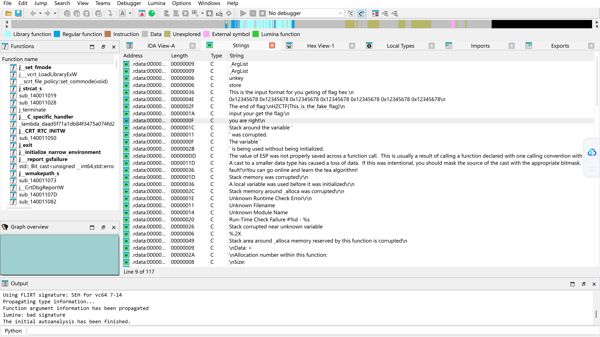
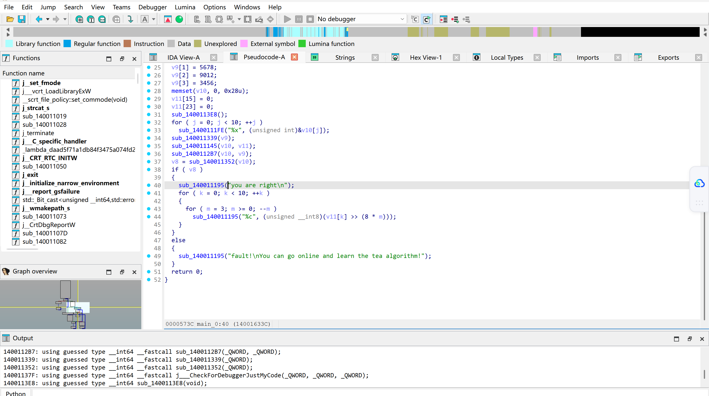
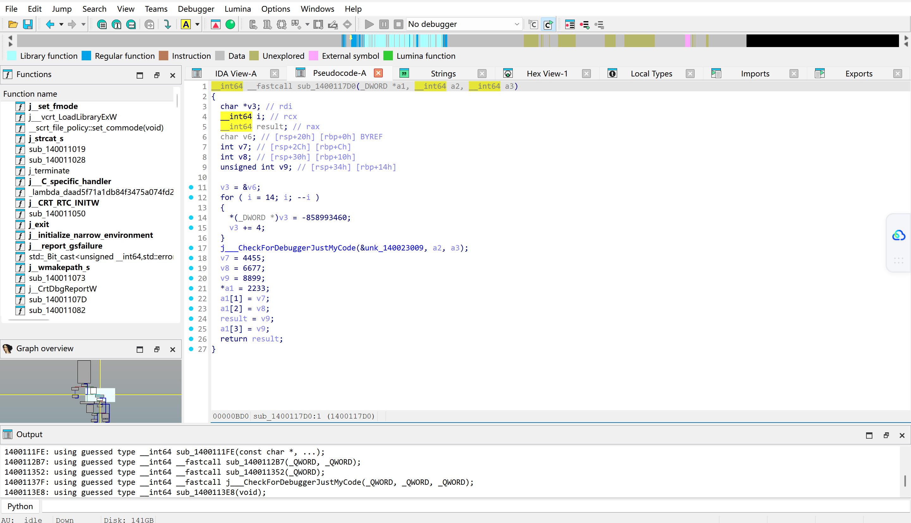
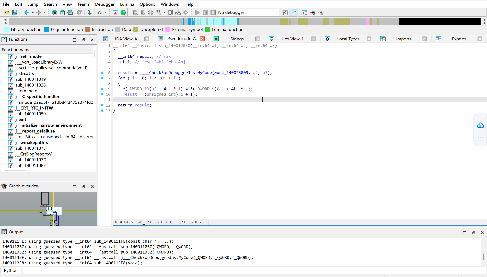
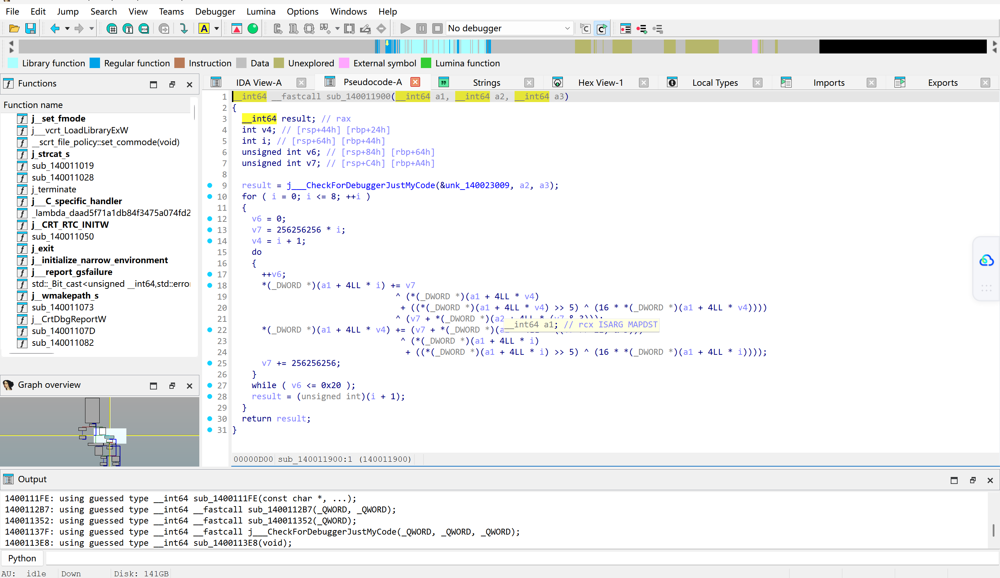
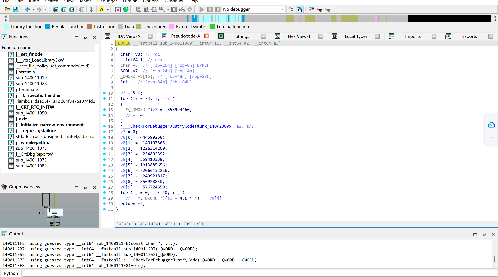

**[GDOUCTF 2023]TEA**

考点：魔改 XTEA

首先查壳，无壳 64 位，放进 IDA 里，先通过字符串找一下逻辑。来到了 main 函数，发现有四个函数。




挨个看看：






很明显四个函数的分工：
1. **第一个函数**对 `v9` 进行了处理，所以最开始的 `v9` 没有用了。
2. **第二个函数**是对我们的输入进行了处理，赋给 `v11`。`v11` 没传入后续两个函数，只是在 44 行打印了一下，所以这个函数和 `v11` 可以先不管。
3. **第三个函数**是一个加密流程，传入了我们输入的 `v10` 和已经被换掉的 `v9`。
4. **第四个函数**则是把加密后的 `v10` 和 `v8` 进行对比，所以这又是一个拿到密文，需要倒推明文的流程。

发现 `v8` 有负有正，位数还差不多，把 `v8` 转成十六进制，发现都是八字节，一共 64 位。加上标题暗示 (tea) 和第三个函数的加密流程 (32 轮，超大常数，左移 4(乘16)，右移 5 等等)，可以确诊是 TEA 家族，进而可以推测出前面的 `v9` 大概率是 TEA 的密钥。

再仔细看看，发现了 `(key + 4LL * (v7 & 3))`，密钥动态索引，这纯纯就是 xTEA。但加密方式稍有变动，最外层有个 for，进行了**类似 CBC 的链式加密**，意思就是先加密第一组和第二组，再加密第二组和第三组。

那还等什么，直接照抄 IDA 里的伪 C(?，把运算符逆推一下就完事了。

脚本如下（变量名不优雅见谅），运行得到的十六进制直接放 Cyberchef，就是 flag 了：

```c
#include <stdio.h>

int main() {
    unsigned int key[4] = { 2233, 4455, 6677, 8899 };
    unsigned int cipher[10] = { 0x1A800BDA, 0xF7A6219B, 0x491811D8, 0xF2013328, 0x156C365B, 0x3C6EAAD8, 0x84D4BF28, 0xF11A7EE7, 0x3313B252, 0xDD9FE279 };
    int i, v1, v2;
    unsigned int chang_liang;

    for (i = 8; i >= 0; i--) {
        v1 = 0;
        chang_liang = 256256256 * (i + 33);
        v2 = i + 1;
        do {
            ++v1;
            chang_liang -= 256256256;
            cipher[v2] -= ((chang_liang + (key[(chang_liang >> 11) & 3]))) ^ ((cipher[i] + ((cipher[i] >> 5) ^ (16 * cipher[i]))));
            cipher[i] -= chang_liang ^ (cipher[v2] + ((cipher[v2] >> 5) ^ (16 * cipher[v2]))) ^ (chang_liang + (key[chang_liang & 3]));
        } while (v1 <= 32);
    }

    for (i = 0; i < 10; ++i) {
        printf("%x", cipher[i]);
    }
    
    return 0;
}