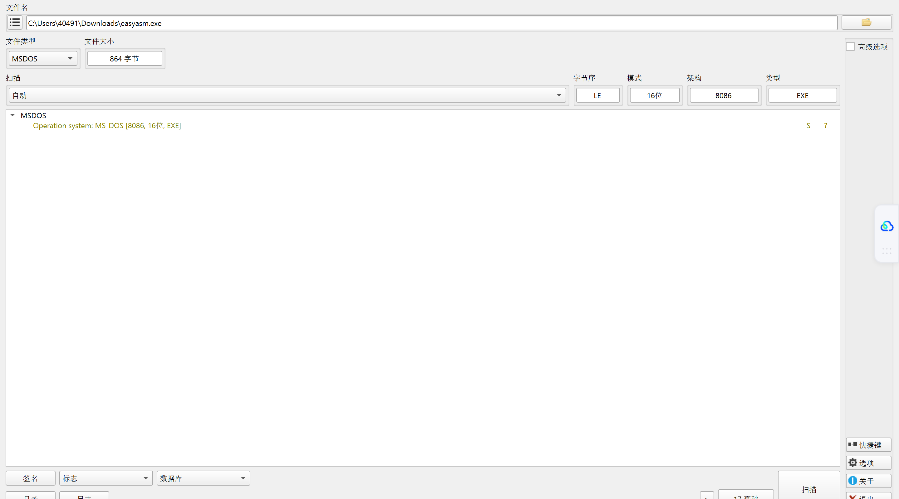
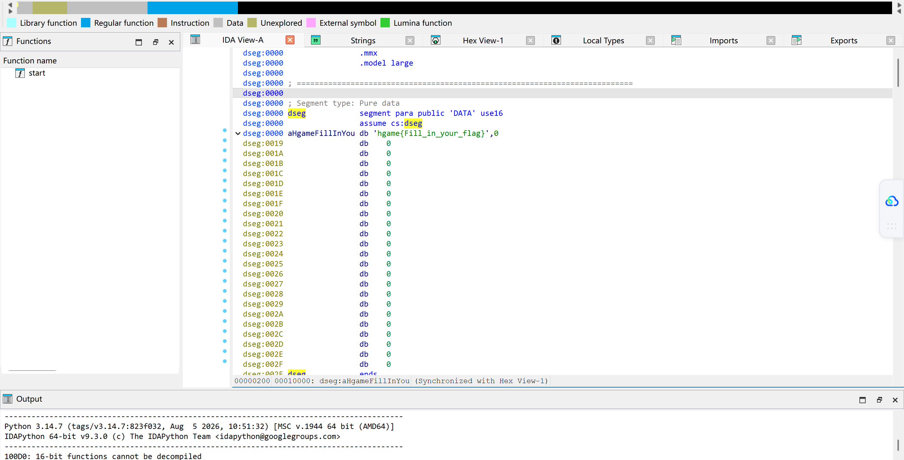
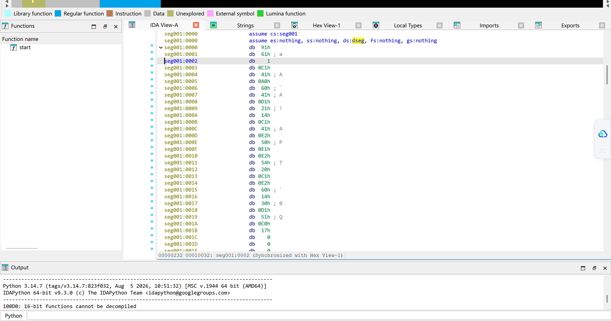
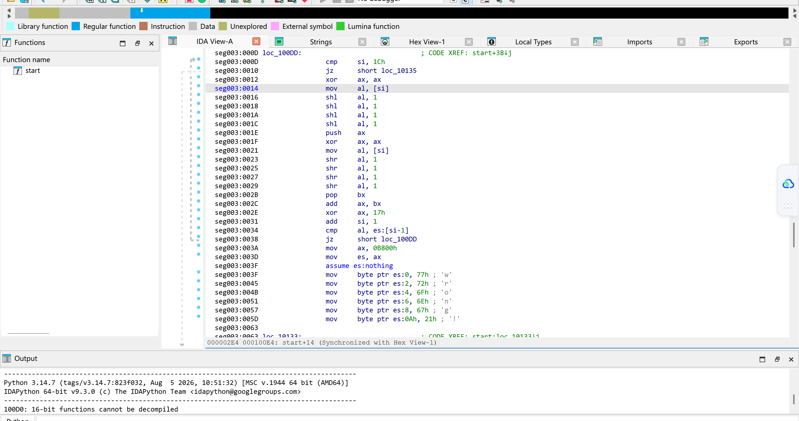

**[HGAME 2022 week1]easyasm**

考点：基础汇编阅读，异或

解题过程和思路：

先把通过下载得到的附件拖DIE检查一下。什么，竟然是16位！刻板印象觉得IDA和xdbg只能调试和分析32/64位的，所以这次用不了了，CPU烧了一会，



但通过查阅资料，得知IDA其实可以反汇编8位和16位架构，只是不能反编译，又看见文件大小只有1kb，分析量很小，放心放IDA里了，只有一个函数。

发现字符串和类似密文的东西。



往下翻发现了简单的逻辑，综合前面的fill in you flag，不难联想到是对输入进行处理，然后和密文比较。`shl` 是左移，`shr` 是右移，最终还有个异或，所以加密逻辑是对输入进行左移4位和右移四位处理，再逐字符和0x17异或。



把前面那串疑似密文的字符串Shift+E提取出来，写逆推脚本，注意高位截断，写逆推代码时不建议一行流，否则不方便检查哪里错了。

```python
cipher = [0x91, 0x61, 0x01, 0xC1, 0x41, 0xA0, 0x60, 0x41, 0xD1, 0x21, 0x14, 0xC1, 0x41, 0xE2, 0x50, 0xE1, 0xE2, 0x54, 0x20, 0xC1, 0xE2, 0x60, 0x14, 0x30, 0xD1, 0x51, 0xC0, 0x17]
flag = ""

for i in range(0, len(cipher)):
    temp = cipher[i] ^ 0x17
    a = ((temp << 4) & 0xFF) | (temp >> 4)
    flag += chr(a)

print(flag)