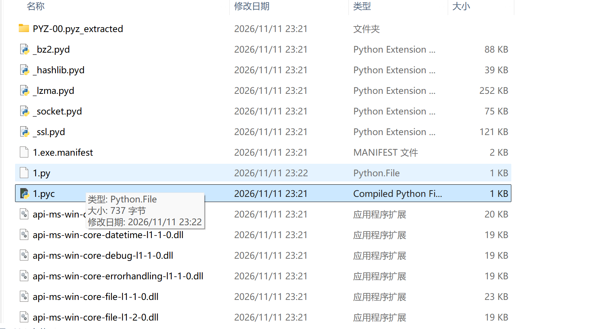
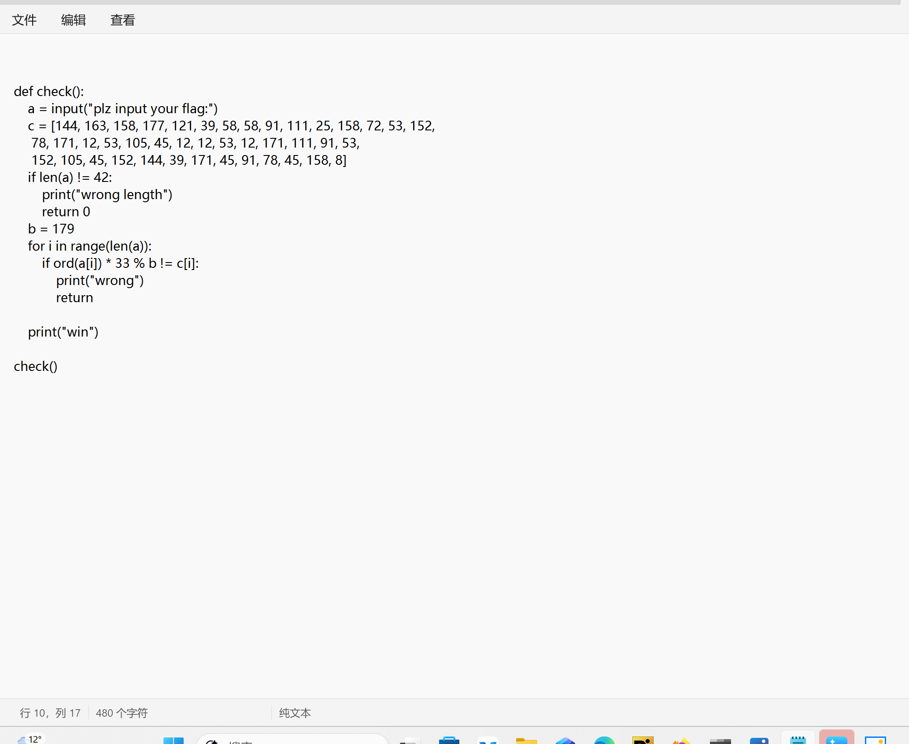

**[广东省大学生攻防大赛 2022]pyre**

考点：py解包，反编译，爆破

下载附件，先解包，找出人为命名的字节码文件 1.pyc 反编译成源代码，得到 1.py



右键记事本，是简单的逻辑，正打算无脑反向过去，结果发现有取模，取模不可逆，结果不唯一，所以不能无脑反推。



所以直接爆破，z3比较常用，但这里计算量不大，直接遍历就行，脚本如下：

```python
c = [144, 163, 158, 177, 121, 39, 58, 58, 91, 111, 25, 158, 72, 53, 152,
     78, 171, 12, 53, 105, 45, 12, 12, 53, 12, 171, 111, 91, 53,
     152, 105, 45, 152, 144, 39, 171, 45, 91, 78, 45, 158, 8]

flag = ''
for i in range(len(c)):
    for j in range(32, 127):
        if (j * 33) % 179 == c[i]:
            flag += chr(j)
            break

print(flag)